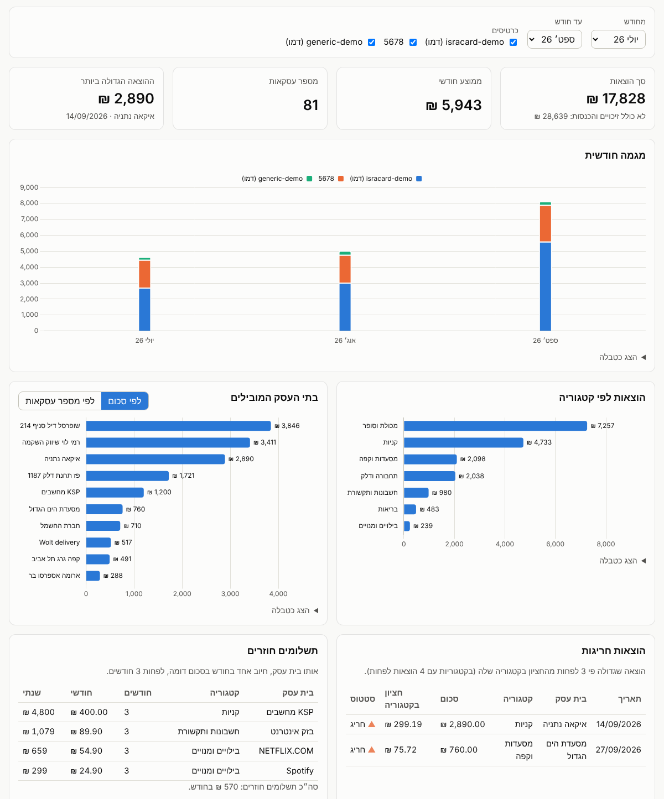

# Expense Insights

Upload credit-card statements from several cards and get an interactive spending dashboard, entirely in the browser. The repo also contains a small command-line version of the same idea for bank-style CSV files.



## Dashboard (`web/`)

Open `web/index.html` in a browser (double-click, no server and no build step) and either drop in statement files or press "Load demo data".

- **Inputs:** `.xlsx` and `.csv`, one file per card. Excel exports with Hebrew headers and title rows above the table are detected automatically; if a file's layout is not recognized, a column-mapping dialog opens. CSV files in UTF-8 or windows-1255 are both read.
- **Views:** monthly spending per card, spending by category, top merchants (by amount or by number of transactions), unusual expenses, recurring payments, and a searchable transaction table. Every chart has a "show as table" view. Filters: month range and cards. Light and dark themes follow the system setting.
- **Categories:** Hebrew and English keyword rules. Change the category of any merchant in the transactions table; the change applies to all its transactions, is kept in the browser's local storage (only these overrides, never transactions) and can be exported and imported as JSON.
- **Privacy:** files are read in the page and never uploaded. A Content-Security-Policy blocks all network access (`connect-src 'none'`), and all libraries are vendored in `web/vendor/`, so it works offline. Merchant names from files are inserted as text, never as HTML.
- **Rules worth knowing:** slash dates are read as DD/MM/YYYY; expenses are counted on their own (refunds and income are listed separately, not netted); installments are shown as billed in the month; foreign-currency rows are excluded only when the amount column is not the billed ILS amount.
- **Unusual expense:** more than 3x the median of its category (categories with at least 4 expenses). **Recurring payment:** one charge per month at a similar amount (within 10%) in at least 3 months.

### Limitations

- **Not verified on real statements.** The layouts of Isracard, Max and Cal exports are modeled on common formats and tested only on synthetic files in `web/samples/` (generated by `scripts/make_samples.py`). Real files may differ; the column-mapping dialog is the fallback.
- PDF statements and the old binary `.xls` format are not supported yet.
- Tested in headless Chromium (Chrome) only, including opening from `file://`; not tried in Firefox or Safari.

## Command line

```
python -m expense_insights data/sample_transactions.csv
python -m expense_insights data/sample_transactions.csv -o report.md
```

Input: CSV with `date` (YYYY-MM-DD), `description`, `amount` (negative = expense). Output for the sample file:

```
# Expense report

## Monthly summary

| Month | Income | Expenses | Net |
|---|---:|---:|---:|
| 2026-07 | 9500.00 | 6161.20 | 3338.80 |
| 2026-08 | 9500.00 | 6623.47 | 2876.53 |
| 2026-09 | 9500.00 | 6849.24 | 2650.76 |

## Spending by category (all months)

- Housing: 11400.00
- Groceries: 3607.96
- Transport: 1712.36
- Dining: 1377.07
- Utilities: 919.65
- Health: 239.67
- Other: 212.50
- Entertainment: 164.70

## Unusual expenses

- 2026-09-28 Restaurant Gourmet - group dinner (Dining): 640.00
```

Requires Python 3.10+, standard library only.

## Tests

```
pip install -r requirements-dev.txt
python -m pytest                      # command-line tool
node --test "web/tests/*.test.js"     # dashboard logic (Node 20+), includes parsing the real .xlsx samples
```

## Layout

- `web/js/parse.js`: dates, amounts, CSV, header detection, rows to transactions.
- `web/js/categories.js`: merchant normalization and keyword categories.
- `web/js/analyze.js`: monthly trend, categories, top merchants, unusual and recurring detection.
- `web/js/app.js`: the interface (no framework). `web/vendor/`: Chart.js 4.6.1 and read-excel-file 9.3.17 (MIT, see `web/vendor/README.md`).
- `expense_insights/`: the Python command-line tool. `SPEC.md`: the dashboard specification.

## What I practiced

Parsing messy real-world exports defensively (Hebrew headers, preamble and totals rows, encodings, ambiguous dates) with exact error rows instead of silent drops; a privacy-by-construction design verifiable through CSP; and testing parsing logic end to end on generated `.xlsx` files, which caught a totals-row bug the unit tests had missed.
